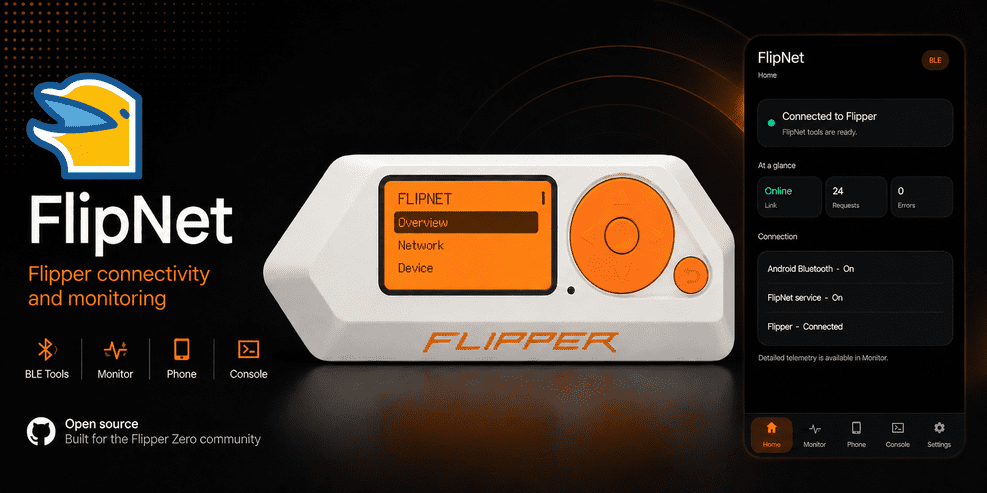

<p align="center">
    
</p>

<h1 align="center">
    <strong>FlipNet</strong>
</h1>

<br>

<p align="center">
    🐬 Portable Flipper Zero interface for network, system and automation tools.<br>
    <sub>For administration, diagnostics, and authorized security testing only.</sub>
</p>

<p align="center">
    <a href="https://github.com/nullmess/FlipNet/stargazers">
        
    </a>
    <a href="LICENSE">
        
    </a>
    
</p>

<p align="center">
    
</p>

---

## ✨ Features

- USB and BLE communication with automatic USB priority
- Dynamic menus based on the active PC or Android companion
- DNS, TLS, HTTP, port scanning and network discovery
- Device health, security, services, VPN and phone information
- Web search, weather, RSS feeds and Wikipedia
- Calculator, units, currency, translation and time tools
- Android application launcher from the Flipper Zero
- Android Companion view combining phone and gateway monitoring
- Android file manager for Flipper SD/internal storage with multi-file/folder upload, download, rename/delete
- Monitors, alerts and protected automation actions
- Targets, groups, favorites and local history
- Declarative desktop plugins without executable code
- Silent background connection checks
- Loading screens shown only for user-requested operations

Unsupported tools are automatically hidden when they are not available on the connected companion.

---

## 🧩 Architecture

```text
Flipper Zero
    ├── USB CDC ─── PC gateway
    ├── BLE ─────── PC gateway
    ├── USB OTG ─── Android gateway
    └── BLE ─────── Android gateway
```

In Auto mode, FlipNet tries USB first, then BLE, then switches to Offline when no gateway is available.

---

## 🚀 Usage

To use this project, follow the steps below from the project directory.

### 1️⃣ Build the Flipper Zero application

Build the FAP with Docker:

```sh
docker compose run --rm --build flipper-build
```

The generated application is written to:

```text
apps/flipper/dist/flipnet.fap
```

Build and launch it directly on a connected Flipper Zero from Linux:

```sh
docker compose run --rm --build flipper-launch
```

### 2️⃣ Install the PC gateway

Install and start the Python gateway:

```sh
python -m pip install ./bridge
flipnet-bridge doctor --strict
flipnet-bridge
```

Linux and Alpine Linux can install it as a system service with:

```sh
./bridge/installers/install-linux.sh
```

On a minimal Alpine Linux host, install the Python tooling first:

```sh
doas apk add python3 py3-pip py3-virtualenv
```

BLE additionally uses D-Bus and BlueZ (`apk add dbus bluez`); USB does not.
The installer supports OpenRC plus udev/eudev or mdev/mdevd and does not
require glibc.

### 3️⃣ Build the Android application

Build the APK with Docker:

```sh
docker compose run --rm --build android-build
```

The Android SDK and Build Tools are already included in the Docker image.
The compilation itself does not download packages from Google or Maven.

The generated APK is written to:

```text
apps/android/dist/flipnet-debug.apk
```

Build and install it on a connected Android device from Linux:

```sh
docker compose run --rm --build android-install
```

---

## 🧱 Components

### Flipper Zero

The FAP provides the menus, connection status, requests and result views. Heavy operations are delegated to the active gateway.

### PC gateway

The Python gateway runs on Linux, macOS and Windows. It provides network, system, Internet, monitoring, workspace and plugin services.

### Android gateway

The Android companion provides BLE and USB OTG connectivity, a unified Companion dashboard, Android applications, direct Flipper file management and a live scrollable console.

### Android navigation

The Android navigation bar is organized as:

```text
Home | Companion | Files | Console | Settings
```

- **Companion** combines gateway monitoring and Phone Link controls in one place.
- **Files** browses the Flipper microSD (`/ext`) and internal (`/int`) storage directly over the active FlipNet USB or BLE link.
- File management supports download, multi-file upload, recursive folder upload, rename, delete and folder creation on the microSD. Internal storage is deliberately read-only.
- Uploads and downloads are transferred in chunks with progress/cancel handling and their file payloads are redacted from the live console.


---

## 🧩 Plugins

FlipNet plugins are declarative `.flipnet-plugin` packages. They cannot contain executable code.

```sh
flipnet-bridge plugin validate ./my-plugin.flipnet-plugin
flipnet-bridge plugin install ./my-plugin.flipnet-plugin --sha256 CHECKSUM
flipnet-bridge plugin list
```

---

## 🛠️ Useful Commands

```text
make fap             Build the Flipper application
make fap-launch      Build and launch it on the Flipper
make android         Build the Android APK
make android-install Build and install the Android APK
make bridge-wheel    Build the Python gateway wheel
make bridge-install  Install the Python gateway
make clean           Remove generated outputs
```

---

## 👤 Author

Give a ⭐️ if this project helped you!

---

## 📄 License

Copyright © 2026 [Nullmess](https://github.com/Nullmess).

This project is licensed under the [MIT License](LICENSE).
